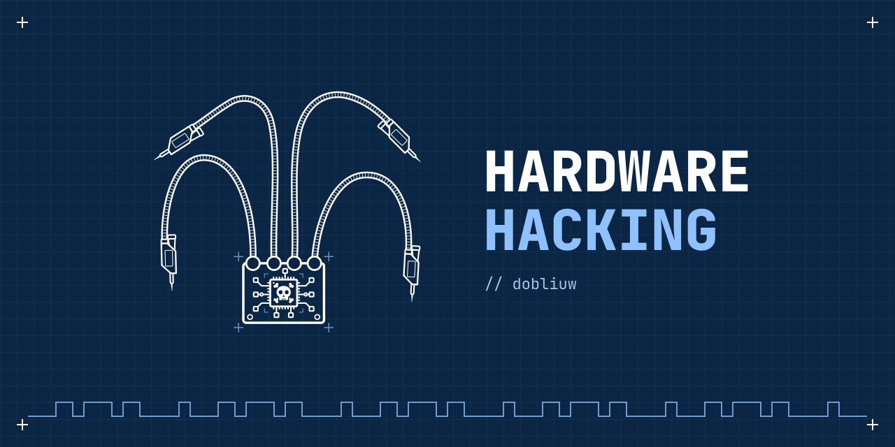

<h1>
  Dobliuw
  — Offensive Security Analyst
</h1>

  

---

### 🔒 About me

Hey! I'm Owen (Dobliuw) passionate about technology and a self-taught researcher focused on offensive cybersecurity. I currently work on **Red Team** for an important organization like **Offensive Security Analyst**

My driving force? The “Why behind the why behind the how?”.

- 📡 I study systems from the core to the most superficial application layer.
- 💣 I am developing my own tools and hardware devices for RF attacks, Bluetooth, Bad USBs, content disclosure, and tutorials and/or classes on cybersecurity, programming, operating systems, and their configuration at the sysadmin level.  
- 🧠 My interests revolve around understanding everything that others use and understanding and being the one who develops this myself.

  

---
### Certifications

- [Certified Professional Penetration Tester](https://certs.ine.com/8e94d54b-59dd-4b31-99cc-1020200180a3#acc.7Wt04KSg) (**eCPPT**).
- [Junior Penetration Tester](https://certs.ine.com/5f514232-a56b-413d-b01e-da126f1b8632#acc.XT1GRb4H) (**eJPT**).
- [Python Ofensivo](https://www.dobliuw.com/assets/certs/python_ofensivo.pdf) (Hack4u).
- [CCNA1](https://www.linkedin.com/in/dev-owen/overlay/Certifications/1016925869/treasury?profileId=ACoAACfjZYsBbimeMwbhwNQ7vfq3miLiClJ9BBo) (CISCO Course).
- [Network Analysis](https://www.dobliuw.com/assets/certs/network_analysis_cert.pdf) (Security Blue Team).
- [Hacking introduction](https://www.dobliuw.com/assets/certs/hacking_introduction.pdf) (Hack4u).
- [API Penetration Testing](https://www.credly.com/badges/ac6e6c45-c780-4a28-8702-902be2bc7433/linked_in_profile) (APIsec University).
- [API Security Fundamentals](https://www.credly.com/badges/607faab5-4379-4749-990b-3ad819daf976/linked_in_profile) (APIsec University).
- [Full Stack Web Developer](https://certificates.soyhenry.com/cert?id=32892f5c-3b00-4fa3-acb8-c66bfb2c40be) (Henry).
- [Sumo Logic Certified](https://verify.skilljar.com/c/ze2rah4k9vvy) (Sumo Logic).
- [Linux](https://www.dobliuw.com/assets/certs/linux_basics.pdf) (Hack4u).

---
### 🎯 Professional work and interests

- 🔐 Ethical Hacking & Red Team (AI Red Teaming, Reversing, Hardware Hacking, traditional pentesting - API, Mobile, Web, OS, WiFi & protocols) and more.
- 💥 Vulnerabilities and Binaries explotation(CVE & PoC crafting)
- 📶 Wireless Hacking (Bluetooth, SDR, NFC, RF)
- 💻 OS Linux and Windows internals
- 🧰 Tools: Wireshark, nmap, Burp Suite, Metasploit, Ghidra, IDA Free, +40k more lol.
- 🔧 Programming: Python, Bash, JavaScript, C and Powershell (Ofcourse can programming in others too)
- 🌐 Networks, protocols and packet analysis
- 🧱 System security & Blue Team (SOC Analyst with knowledge in EDRs, SIEMs and Reporting).
- 🔌 Electronics development oriented to Home Labs, custom servers and sysadmin works.
 
---

### 🧭 Currently learning and working on

- 🏅HTB Certified Offensive AI Expert IN PROGRESS
- 🎓 Electronics Engineering on UTN.
- 🧠 Saving $ to certificate **Maldev Academy - Malware development + Ransomwares**, **OSCP**, **OSWE** (And ofcourse more).
- ⚙️ And... my main interest aiming to 2030.... 

  

 

I'm currently participating in study groups and applying what I know (while learning new things) in **hardware hacking** projects, where I'm trying to root devices, dump firmware and AES keys, and exploit UART, SPI, and JTAG protocols, among others, on the PCBs of various devices, such as security cameras, routers, set-top boxes, digital locks with NFC and codes, and much more!

Ah, I almost forgot.... 

(My main personal goal is create articles for the community in Markdown, so.....)

<a href="https://dobliuw.com/static_site/README.html">Click here to see my articles.</a>

---

### 📫 Contact me 

- ✉️ dobliuw@dobliuw.com
- 🌐 [LinkedIn](https://www.linkedin.com/in/dev-owen/)
- 🔎 [Click here to see more options](https://dobliuw.com/info)
---

### 💡 Manifesto

> *“Don't delegate the brain process to the AI and really learn how tools and world work — learn why they were built, how and why they fail, and how to build your own real world solutions.”*

---

Att.

